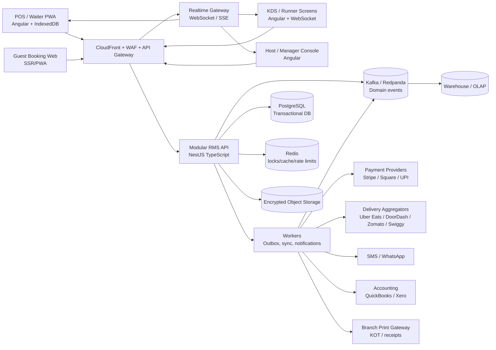

# Restaurant Management System (RMS)

**Status:** Production-ready target specification  
**Audience:** Product, engineering, security, operations, and implementation partners  
**Scope:** Multi-tenant, multi-branch restaurant operations for dine-in, takeaway, and online delivery

## 1. Product Definition

RMS is an operational system for restaurants that need one source of truth for orders, kitchen execution, tables, stock, people, guests, integrations, and financial reporting. A tenant represents a restaurant group. A tenant can own many branches, and every operational record is scoped to a branch unless explicitly marked tenant-wide.

### 1.1 Operating principles

- **Order is the spine:** a single order lifecycle connects POS, KDS, payments, inventory, dispatch, CRM, and reporting.
- **Financial immutability:** posted sales, payments, tax lines, stock movements, and audit events are append-only; corrections are compensating transactions.
- **Offline by design:** supported POS devices can continue taking orders and payments during connectivity loss, with deterministic synchronization after reconnection.
- **Branch autonomy with central control:** menus, roles, tax rules, and integrations can inherit from the tenant and be overridden at branch level.
- **Operational timestamps:** store event times in UTC and render in the branch's configured IANA time zone.

### 1.2 Roles and primary workflows

| Role | Primary capabilities |
|---|---|
| Admin | Tenant setup, billing, security policy, integrations, all branches |
| Manager | Branch operations, approvals, reports, staff, inventory, reservations |
| Waiter | Table service, table-side ordering, order changes, split/merge checks |
| Cashier | Payments, refunds subject to policy, drawer open/close, receipts |
| Chef | KDS, station routing, prep status, item exceptions |
| Runner | Ready-order pickup, table/delivery handoff, delivery status |
| Inventory manager | Recipes, counts, POs, receiving, waste, stock adjustments |
| Marketing user | Guest segments, campaigns, feedback and loyalty configuration |
| Auditor | Read-only access to financial and audit records |

## 2. Functional Scope

### 2.1 POS and billing

- Create orders for dine-in, takeaway, pickup, and delivery; attach branch, table, guest, channel, and source device.
- Add menu items, modifiers, combos, notes, allergens, courses, and seat numbers.
- Hold, resume, void, comp, transfer, merge, and split orders subject to role permissions.
- Support item-level and check-level discounts with reason codes, approval thresholds, coupon rules, and a non-stackable/stackable policy.
- Calculate jurisdiction-specific GST/VAT/sales tax from versioned tax rules. Persist the applied tax rate and calculation inputs on each line so historical bills do not change when rules change.
- Support tips by fixed amount or percentage, including tip allocation and tip-pool settlement.
- Accept cash, card terminal, digital wallet, UPI, gift card, house account, and split tender. Payment provider tokens, not PAN, are stored by RMS.
- Print or render customer receipts, kitchen order tickets (KOT), refund receipts, and end-of-shift reports. Printers are branch/device resources with retry and spool status.
- Use idempotency keys for every order and payment command. A retry must never create a second order, charge, or stock deduction.

**Order state machine:** `OPEN -> SENT -> IN_PREPARATION -> READY -> SERVED/FULFILLED -> CLOSED`; allowed exception paths are `OPEN -> VOID`, `SENT -> CANCELLED`, and `CLOSED -> REFUNDED` through compensating records. A delivery order also carries a dispatch state independently.

### 2.2 Kitchen Display System and dispatch

- Route KOT tickets and individual items to one or more prep stations using item category, branch, channel, and menu configuration.
- Show a live queue grouped by station with priority, promised time, elapsed/prep timer, allergens, modifiers, course, seat, and order type.
- Track item status `PENDING`, `COOKING`, `READY`, `SERVED`, `CANCELLED`, and `REMAKE`.
- Allow station bump, recall, pause, outage mode, and manager override; retain who changed the state and why.
- Publish changes over WebSocket/SSE with sequence numbers. Clients reconnect from their last acknowledged sequence.
- Coordinate food runners with a ready queue, pickup confirmation, table/guest destination, and delivery handoff scan.
- Record target prep time, actual prep time, lateness reason, and station throughput for analytics.

### 2.3 Floor, reservations, and waitlist

- Maintain a versioned 2D floor plan containing tables, seats, zones, shape, position, capacity, accessibility, and merge relationships.
- Compute real-time table status: `AVAILABLE`, `OCCUPIED`, `RESERVED`, `SEATED`, `CLEANING`, `OUT_OF_SERVICE`.
- Prevent double seating with a transactional table assignment and a short-lived host lock.
- Support reservations with party size, duration, seating preferences, source, deposit, confirmation state, cancellation/no-show policy, and notes.
- Manage walk-ins and waitlist entries with quoted wait time, SMS/WhatsApp consent, notification history, and expiration.
- Send booking confirmations, reminders, changes, waitlist offers, and cancellation notices through an integration outbox. Templates are localized and opt-out aware.

### 2.4 Inventory, purchasing, and recipe costing

- Track ingredients, packaging, units, batches/lots, expiry, storage location, supplier, par levels, reorder points, and branch-specific costing.
- Model every stock change as a `stock_movement`: purchase receipt, recipe consumption, transfer, count adjustment, waste, return, or reversal.
- Deduct ingredients automatically when a qualifying order line reaches the configured consumption event, normally `SENT` or `FULFILLED`; the policy is branch configurable and must be consistent.
- Support recipes with yield, preparation loss, sub-recipes, alternatives, modifiers, and unit conversions.
- Create, approve, send, receive, partially receive, and close supplier purchase orders. Capture unit cost, tax, lot, expiry, and receiving discrepancies.
- Record waste with reason, quantity, cost, user, station, and optional photo/evidence.
- Alert on projected stockout, expired stock, negative stock, unusual variance, and food-cost margin breach.
- Calculate theoretical cost, actual cost, gross margin, waste percentage, stock variance, and contribution margin by item, category, branch, and period.

### 2.5 Menu and dynamic pricing

- Publish versioned menus to channels and branches with availability windows for breakfast, lunch, happy hour, seasonal, and delivery menus.
- Support categories, items, variants, modifiers, modifier groups, add-ons, combos, bundles, allergens, nutrition data, images, and prep stations.
- Apply pricing rules by time window, day, branch, channel, demand band, inventory threshold, membership tier, and promotion. Rules have explicit priority and an explainable price decision record.
- Never mutate an already-issued order price; menu publication affects only new calculations.
- Validate modifier constraints, out-of-stock visibility, tax category, and KDS routing before publication.

### 2.6 Staff and shift operations

- Provide RBAC with branch scope, permission grants, approval limits, and optional separation-of-duties rules.
- Support clock-in/out, breaks, schedule, station assignment, attendance corrections, and manager approval.
- Open a cash drawer with opening float; record sales, paid-ins, paid-outs, tips, refunds, cash drops, and counted close.
- Reconcile expected versus counted cash and record over/short variance with reason and approval.
- Support tip pooling by shift, role, hours, points, or configurable weighted rule. Freeze the input set before payout and retain the calculation snapshot.

### 2.7 CRM, loyalty, and feedback

- Maintain guest profiles with consent, contact channels, preferences, allergies supplied by the guest, visit history, spend, reservations, and marketing eligibility.
- Earn/redeem loyalty points from settled transactions with a ledger, expiry policy, fraud limits, and manual adjustment approvals.
- Send post-visit feedback requests with order/visit correlation, channel consent, throttling, and escalation for low scores.
- Segment guests by recency/frequency/monetary value, preferences, branch, channel, consent, and loyalty tier. Campaigns support audience preview, scheduling, frequency caps, delivery events, unsubscribe, and attribution.

### 2.8 Integrations

Use an adapter boundary so provider-specific payloads never leak into core entities.

- Delivery: Uber Eats, DoorDash, Zomato, Swiggy. Ingest orders and menu availability; acknowledge, accept/reject, update prep time, cancel under policy, and publish status/tracking.
- Accounting: QuickBooks and Xero. Export settled sales summaries, taxes, tender totals, tips, refunds, fees, COGS, and supplier bills using a reconciliation key.
- Payments: Stripe, Square, and UPI-compatible provider. Use hosted/tokenized flows where possible, terminal APIs for card-present transactions, webhooks, idempotent capture/refund, and settlement reconciliation.
- Messaging: SMS and WhatsApp provider adapter for reservations, waitlist, receipts, and campaigns.
- Every outbound integration uses an outbox, retry policy, exponential backoff, dead-letter state, provider correlation ID, and replay-safe idempotency key.

### 2.9 Analytics and BI

The operational database serves current workflows; reporting uses an event/warehouse projection.

- Real-time KPIs: gross/net sales, orders, average check, covers, payment mix, refunds, open tickets, prep SLA, table turns, and stock alerts.
- Heatmaps: sales and covers by weekday/hour, branch, channel, table zone, station, and daypart.
- Sales mix/Boston Matrix: classify menu items using popularity and contribution margin into stars, plowhorses, puzzles, and dogs.
- Staff efficiency: orders per labor hour, average service time, prep SLA, void/discount patterns, and tip distribution.
- Inventory variance: theoretical versus actual consumption, waste, count variance, supplier price variance, stockout rate, and days of cover.
- Dashboards must show data freshness, timezone, filters, drill-through, export permissions, and metric definitions.

## 3. Recommended System Architecture

### 3.1 Stack

| Layer | Recommendation | Rationale |
|---|---|---|
| POS/KDS/admin frontend | Angular 22, TypeScript, standalone components, RxJS, service worker/PWA, IndexedDB via Dexie | Fits the current workspace; resilient tablet/desktop workflows and offline cache |
| Public booking/guest web | Angular SSR or a lightweight server-rendered app sharing typed API clients | SEO and fast mobile reservation flow |
| API | NestJS/TypeScript modular monolith initially, REST for commands/queries and WebSocket gateway for live operations | Strong typing, fast delivery, clear path to service extraction |
| Domain messaging | Transactional outbox plus Kafka or Redpanda when event volume requires it | Reliable integration and analytics fan-out |
| Primary database | PostgreSQL 16+, one logical database with tenant/branch scoping and row-level security | ACID order/payment/inventory workflows and rich reporting queries |
| Cache/coordination | Redis for short-lived locks, rate limits, sessions, and read cache | Low-latency table locks and hot operational reads |
| Search | OpenSearch only when guest/menu/operational search exceeds PostgreSQL needs | Avoid premature platform complexity |
| Object storage | S3-compatible encrypted bucket for receipts, exports, menu media, and waste evidence | Durable, private media and retention policies |
| Realtime | WebSockets for authenticated interactive screens; SSE fallback for read-only displays | Low-latency KDS/floor updates with reconnect sequencing |
| Analytics | CDC/event stream to BigQuery, Snowflake, or ClickHouse; dbt semantic models | Historical, cross-branch analytics without burdening POS transactions |
| Hosting | AWS: ECS/Fargate or EKS, RDS PostgreSQL Multi-AZ, ElastiCache, MSK/Redpanda Cloud, S3, CloudFront, WAF, KMS, Secrets Manager | Managed operational baseline with regional failover options |
| Observability | OpenTelemetry, Prometheus, Grafana, Loki/CloudWatch, Sentry | Correlated traces across POS, provider adapters, and async jobs |
| Delivery | GitHub Actions, Terraform, Docker, environment promotion, migrations as release artifacts | Repeatable and auditable deployments |

Start as a modular monolith with bounded modules (`identity`, `catalog`, `orders`, `payments`, `kitchen`, `floor`, `inventory`, `workforce`, `crm`, `integrations`, `reporting`). Extract a module only when scale, isolation, or team ownership justifies the operational cost.

### 3.2 High-level architecture



### 3.3 Availability and operating targets

Initial production targets, measured per tenant/branch unless stated otherwise:

- API availability: 99.95% monthly for core order and payment APIs.
- POS command p95: under 300 ms online excluding provider authorization; KDS event propagation p95 under 2 seconds.
- Recovery point objective: under 5 minutes; recovery time objective: under 30 minutes for regional service failure.
- Offline POS: at least 72 hours of locally retained authorized operational data, subject to device storage and policy.
- Backup: continuous WAL/PITR plus daily encrypted snapshots, quarterly restore drills.
- Scale target: 10,000 branches, 2,000 concurrent devices per region, and 250 order mutations per second per region after horizontal scaling.

## 4. Database Schema Outline

All tables include `id UUID`, `created_at`, `updated_at`, and, where relevant, `created_by`, `updated_by`, `version`, `deleted_at`, and `tenant_id`. Use UUIDv7 where available. Monetary values are integer minor units plus `currency_code`; never use floating point for money. Quantities use `NUMERIC` with explicit `unit_code`.

### 4.1 Identity and organization

| Table | Key fields |
|---|---|
| `tenants` | `id PK`, `name`, `default_currency`, `default_timezone`, `status` |
| `branches` | `id PK`, `tenant_id FK`, `code UNIQUE(tenant_id, code)`, `name`, `timezone`, `address`, `tax_profile_id FK` |
| `users` | `id PK`, `tenant_id FK`, `email`, `phone`, `status`, `last_login_at` |
| `roles` | `id PK`, `tenant_id FK`, `name`, `system_role` |
| `permissions` | `id PK`, `code UNIQUE`, `description` |
| `user_roles` | `user_id FK`, `role_id FK`, `branch_id FK NULL`, `PK(user_id, role_id, branch_id)` |
| `devices` | `id PK`, `branch_id FK`, `device_type`, `name`, `public_key`, `last_sync_cursor`, `status` |
| `audit_events` | `id PK`, `tenant_id FK`, `branch_id FK NULL`, `actor_id FK`, `action`, `entity_type`, `entity_id`, `before_json`, `after_json`, `reason`, `ip`, `correlation_id` |

### 4.2 Catalog and pricing

| Table | Key fields |
|---|---|
| `menus` | `id PK`, `tenant_id FK`, `name`, `channel`, `status` |
| `menu_versions` | `id PK`, `menu_id FK`, `effective_from`, `effective_to`, `published_by`, `status` |
| `menu_items` | `id PK`, `tenant_id FK`, `sku`, `name`, `category_id FK`, `tax_category_id FK`, `active` |
| `menu_version_items` | `menu_version_id FK`, `menu_item_id FK`, `price_minor`, `branch_id FK NULL`, `availability_rule_json`, `PK(menu_version_id, menu_item_id, branch_id)` |
| `modifier_groups` | `id PK`, `name`, `min_select`, `max_select`, `required` |
| `modifiers` | `id PK`, `modifier_group_id FK`, `name`, `price_delta_minor`, `allergen_codes` |
| `menu_item_modifiers` | `menu_item_id FK`, `modifier_group_id FK`, `sort_order`, `PK(menu_item_id, modifier_group_id)` |
| `recipes` | `id PK`, `menu_item_id FK`, `version`, `yield_qty`, `yield_unit`, `effective_from`, `active` |
| `recipe_lines` | `id PK`, `recipe_id FK`, `ingredient_id FK`, `quantity`, `unit_code`, `loss_percent`, `optional` |
| `pricing_rules` | `id PK`, `tenant_id FK`, `priority`, `conditions_json`, `action_json`, `effective_window`, `stacking_policy`, `active` |
| `tax_rates` | `id PK`, `tenant_id FK`, `jurisdiction`, `code`, `rate_basis_points`, `effective_from`, `effective_to` |

### 4.3 Orders, kitchen, payments, and floor

| Table | Key fields |
|---|---|
| `orders` | `id PK`, `tenant_id FK`, `branch_id FK`, `order_number`, `order_type`, `source`, `status`, `table_id FK NULL`, `guest_id FK NULL`, `currency_code`, `subtotal_minor`, `discount_minor`, `tax_minor`, `tip_minor`, `total_minor`, `idempotency_key UNIQUE(branch_id, idempotency_key)` |
| `order_items` | `id PK`, `order_id FK`, `menu_item_id FK`, `name_snapshot`, `quantity`, `unit_price_minor`, `discount_minor`, `tax_minor`, `status`, `seat_no`, `notes`, `consumption_event` |
| `order_item_modifiers` | `id PK`, `order_item_id FK`, `modifier_id FK`, `name_snapshot`, `price_delta_minor`, `quantity` |
| `order_events` | `id PK`, `order_id FK`, `sequence`, `event_type`, `payload_json`, `actor_id FK`, `occurred_at`, `UNIQUE(order_id, sequence)` |
| `kitchen_tickets` | `id PK`, `order_id FK`, `station_id FK`, `status`, `priority`, `promised_at`, `sent_at`, `ready_at` |
| `kitchen_ticket_items` | `ticket_id FK`, `order_item_id FK`, `status`, `started_at`, `completed_at`, `PK(ticket_id, order_item_id)` |
| `tables` | `id PK`, `branch_id FK`, `label`, `capacity`, `zone_id FK`, `status`, `x`, `y`, `width`, `height`, `shape`, `floor_version` |
| `table_combinations` | `id PK`, `branch_id FK`, `table_ids`, `active` |
| `reservations` | `id PK`, `branch_id FK`, `guest_id FK`, `starts_at`, `ends_at`, `party_size`, `status`, `confirmation_token_hash`, `source` |
| `waitlist_entries` | `id PK`, `branch_id FK`, `guest_id FK NULL`, `party_size`, `quoted_minutes`, `status`, `expires_at`, `consent_snapshot_json` |
| `payments` | `id PK`, `order_id FK`, `tender_type`, `provider`, `provider_payment_id`, `amount_minor`, `tip_minor`, `status`, `idempotency_key`, `captured_at` |
| `refunds` | `id PK`, `payment_id FK`, `amount_minor`, `reason`, `provider_refund_id`, `status`, `approved_by FK` |
| `cash_drawers` | `id PK`, `branch_id FK`, `device_id FK`, `opened_by FK`, `opening_float_minor`, `closed_by FK`, `expected_minor`, `counted_minor`, `variance_minor`, `status` |
| `cash_movements` | `id PK`, `drawer_id FK`, `type`, `amount_minor`, `reason`, `order_id FK NULL`, `approved_by FK NULL` |

### 4.4 Inventory, workforce, CRM, and integrations

| Table | Key fields |
|---|---|
| `ingredients` | `id PK`, `tenant_id FK`, `sku`, `name`, `base_unit`, `allergen_codes`, `active` |
| `stock_locations` | `id PK`, `branch_id FK`, `name`, `type` |
| `stock_balances` | `ingredient_id FK`, `location_id FK`, `on_hand_qty`, `reserved_qty`, `average_cost_minor`, `version`, `PK(ingredient_id, location_id)` |
| `stock_movements` | `id PK`, `ingredient_id FK`, `location_id FK`, `type`, `quantity_delta`, `unit_cost_minor`, `source_type`, `source_id`, `lot_id FK NULL`, `occurred_at` |
| `suppliers` | `id PK`, `tenant_id FK`, `name`, `contact_json`, `payment_terms` |
| `purchase_orders` | `id PK`, `branch_id FK`, `supplier_id FK`, `number`, `status`, `ordered_at`, `expected_at`, `total_minor` |
| `purchase_order_lines` | `id PK`, `purchase_order_id FK`, `ingredient_id FK`, `ordered_qty`, `received_qty`, `unit_cost_minor`, `tax_minor` |
| `waste_logs` | `id PK`, `branch_id FK`, `ingredient_id FK`, `quantity`, `unit_cost_minor`, `reason_code`, `station_id FK NULL`, `approved_by FK NULL` |
| `employees` | `id PK`, `tenant_id FK`, `user_id FK`, `employee_number`, `employment_status` |
| `shifts` | `id PK`, `branch_id FK`, `starts_at`, `ends_at`, `status`, `manager_id FK` |
| `time_entries` | `id PK`, `employee_id FK`, `shift_id FK`, `clock_in`, `clock_out`, `breaks_json`, `approved_by FK NULL` |
| `tip_pools` | `id PK`, `shift_id FK`, `basis`, `total_minor`, `calculation_snapshot_json`, `status` |
| `guests` | `id PK`, `tenant_id FK`, `phone_hash`, `email_hash`, `display_name`, `consent_json`, `marketing_status` |
| `loyalty_accounts` | `id PK`, `guest_id FK UNIQUE`, `tier`, `points_balance` |
| `loyalty_ledger` | `id PK`, `account_id FK`, `points_delta`, `reason`, `order_id FK NULL`, `expires_at` |
| `feedback_requests` | `id PK`, `order_id FK`, `guest_id FK`, `channel`, `token_hash`, `status`, `score`, `submitted_at` |
| `integration_connections` | `id PK`, `tenant_id FK`, `branch_id FK NULL`, `provider`, `encrypted_credentials_ref`, `status`, `last_sync_at` |
| `integration_messages` | `id PK`, `provider`, `direction`, `idempotency_key`, `payload_ref`, `status`, `attempts`, `next_attempt_at`, `provider_id` |
| `outbox_events` | `id PK`, `aggregate_type`, `aggregate_id`, `event_type`, `payload_json`, `published_at`, `attempts`, `last_error` |

**Integrity constraints:** unique order number per branch/day, unique provider event IDs, no negative payment/refund beyond policy, no stock movement without a source, no overlapping active menu versions for the same scope, and check constraints for non-negative quantities and valid state transitions. Use optimistic `version` checks for editable aggregates and database transactions for order/payment/inventory boundaries.

## 5. Core API Contracts

Base URL: `/api/v1`. JSON uses ISO-8601 timestamps and integer minor-unit money. All mutating requests require `Authorization: Bearer <access-token>`, `X-Branch-Id`, `X-Device-Id`, `X-Correlation-Id`, and `Idempotency-Key` where stated. Responses include `requestId` and `version` where relevant.

### 5.1 Place an order

`POST /branches/{branchId}/orders`

Request:

```json
{
  "orderType": "DINE_IN",
  "tableId": "tbl_01J...",
  "guestId": "gst_01J...",
  "menuVersionId": "menv_01J...",
  "items": [
    {
      "menuItemId": "item_burger",
      "quantity": 2,
      "seatNo": 1,
      "modifierIds": ["mod_no_onion"],
      "notes": "Extra napkins"
    }
  ],
  "discounts": [],
  "tip": { "mode": "PERCENT", "value": 10 },
  "source": "POS"
}
```

Response `201`:

```json
{
  "order": {
    "id": "ord_01J...",
    "orderNumber": "A-1042",
    "status": "OPEN",
    "currency": "INR",
    "totals": {
      "subtotalMinor": 180000,
      "discountMinor": 0,
      "taxMinor": 32400,
      "tipMinor": 18000,
      "totalMinor": 230400
    },
    "items": [],
    "version": 1
  },
  "events": ["ORDER_CREATED", "PRICE_CALCULATED"]
}
```

Errors: `409 ORDER_IDEMPOTENCY_CONFLICT`, `409 TABLE_NOT_AVAILABLE`, `422 MENU_ITEM_UNAVAILABLE`, `422 MODIFIER_INVALID`, `403 DISCOUNT_APPROVAL_REQUIRED`.

### 5.2 Send order to kitchen

`POST /orders/{orderId}/send`

Body: `{ "coursePolicy": "ALL", "consumptionEvent": "SENT" }`

The server locks the order version, validates the transition, snapshots prices/taxes, creates station tickets, writes an outbox event, and creates stock-consumption movements in the same transaction when configured for `SENT` deduction. Response: `202` with `orderVersion`, `ticketIds`, `stockMovementIds`, and `realtimeSequence`.

### 5.3 Update a kitchen ticket

`PATCH /kitchen/tickets/{ticketId}`

```json
{
  "status": "READY",
  "expectedVersion": 4,
  "reason": null
}
```

The endpoint is idempotent for the same target state and expected version. It publishes `KITCHEN_TICKET_UPDATED` to the branch realtime channel and updates order readiness projections.

### 5.4 Capture payment and close order

`POST /orders/{orderId}/payments`

```json
{
  "tenders": [
    { "type": "CARD", "provider": "STRIPE_TERMINAL", "amountMinor": 200000, "providerToken": "tok_terminal_..." },
    { "type": "CASH", "amountMinor": 30400 }
  ],
  "tipMinor": 18000,
  "closeOrder": true
}
```

Response: `201` with payment statuses, remaining balance, receipt URL, and order status. Provider authorization may be asynchronous: return `202` with `paymentId` and poll/subscribe to status. Never accept raw card PAN, CVV, or magnetic-stripe data.

### 5.5 Inventory deduction

`POST /inventory/consumptions`

```json
{
  "sourceType": "ORDER",
  "sourceId": "ord_01J...",
  "event": "SENT",
  "items": [
    { "recipeId": "recipe_burger_v3", "quantity": 2 }
  ]
}
```

Response: `201` with generated movements and warnings. The operation is idempotent by `(sourceType, sourceId, event)`. It locks affected `stock_balances`, applies recipe yield and unit conversion, writes movements, updates balances, and emits `INVENTORY_DEDUCTED`. If stock is insufficient, behavior is branch policy: allow negative with alert, block send, or substitute/manager override. The policy decision is always recorded.

### 5.6 Reservations and live updates

- `GET /branches/{branchId}/floor?at=...` returns floor version, tables, reservations, and active locks.
- `POST /branches/{branchId}/reservations` creates a reservation using an idempotency key.
- `POST /waitlist/{entryId}/offer` sends a timed seating offer.
- `GET /branches/{branchId}/events?after={sequence}` provides replay for reconnecting clients.
- `WS /realtime/branches/{branchId}` subscribes to `order.*`, `kitchen.*`, `table.*`, `reservation.*`, and `inventory.alert.*` topics after authorization.

### 5.7 Common API conventions

- Cursor pagination: `?limit=50&after=cursor`.
- Filtering and sorting are allowlisted per endpoint.
- Errors use RFC 7807 `application/problem+json` with `code`, `message`, `details`, and `requestId`.
- Mutations require optimistic concurrency where a user edits a shared resource: `If-Match: "version"` or `expectedVersion`.
- Webhook endpoints verify provider signatures, persist the raw event reference, acknowledge quickly, and process asynchronously.

## 6. Offline Mode and Conflict Resolution

### 6.1 Device model

The POS PWA stores a branch-scoped encrypted local database containing menu snapshots, tax/pricing snapshots, table/floor snapshot, open orders, queued commands, receipt templates, and the last server cursor. The device has a registered key pair; commands are signed with the device key and contain a monotonic device sequence.

Offline support is intentionally limited to operations that can be reconciled safely: create/edit open orders, print KOT/customer receipts from local data, mark operational statuses, and record cash tender. Provider-dependent card authorization requires an approved terminal offline capability or remains pending; the UI must clearly distinguish `AUTHORIZED`, `PENDING`, and `NOT_AUTHORIZED`.

### 6.2 Sync protocol

1. Device sends `POST /sync/commands` with a batch of signed commands, base server cursor, device sequence range, and idempotency keys.
2. Server validates tenant/branch/device authorization, signature, schema, sequence monotonicity, and command idempotency.
3. Server applies commands in causal order in transactions and returns per-command `APPLIED`, `ALREADY_APPLIED`, `REJECTED`, or `CONFLICT` results plus a new cursor.
4. Device applies the authoritative event stream, marks acknowledged commands, and preserves rejected commands for user-visible resolution.
5. Device requests missing events from `GET /events?after=cursor`; event sequence is the replay source, not a client timestamp.

### 6.3 Conflict rules

- **Order creation:** merge only by idempotency key; different keys create separate orders.
- **Order line edits:** server version wins for closed/sent lines. For open lines, use command ordering; a conflicting edit becomes a review task rather than silently overwriting.
- **Table assignment:** transactional server lock wins. The losing device receives `TABLE_ALREADY_ASSIGNED` and must choose another table or merge with authorization.
- **Inventory:** never last-write-wins stock. Each consumption/receipt is an immutable movement; balance is recalculated from movements or rejected when policy forbids negative stock.
- **Payments:** provider transaction ID and idempotency key are authoritative. A locally recorded cash payment can be reconciled; a card payment cannot be marked captured without provider confirmation.
- **Configuration:** published menu/tax versions are immutable. Devices sync a new version and keep the snapshot ID used for any offline order.

## 7. Security, Privacy, and Compliance

### 7.1 Identity and access

- OIDC/OAuth 2.1 with short-lived access tokens, rotating refresh tokens, MFA for privileged roles, and optional SSO/SAML for enterprise tenants.
- Enforce tenant and branch authorization in the API and database row-level security; never rely only on a client-supplied branch ID.
- Device registration requires manager approval, device key attestation/rotation, revocation, and last-seen monitoring.
- Use least privilege, branch-scoped roles, approval workflows for refunds/voids/discounts/stock adjustments, and separation of duties for payout and reconciliation.
- Rate-limit login, payments, webhooks, messaging, exports, and sync endpoints. Protect against replay with nonce/sequence/idempotency validation.

### 7.2 PCI DSS and payment handling

- Prefer hosted checkout, provider tokenization, and certified card-present terminals so RMS systems do not receive PAN/CVV.
- Segment payment terminals and printer/IoT networks from application infrastructure. Use TLS 1.2+ in transit and KMS-backed encryption at rest.
- Store only provider payment IDs, brand/last-four where permitted, authorization/capture status, and reconciliation metadata.
- Maintain PCI scope inventory, quarterly vulnerability scans, access reviews, key rotation, incident response, and provider responsibility matrix. Do not log payment secrets or full webhook payloads containing sensitive data.

### 7.3 Data protection

- Classify guest contact data, payment metadata, employee data, and operational data. Encrypt sensitive fields or references; hash lookup identifiers such as email/phone where feasible.
- Support consent capture, purpose limitation, unsubscribe, retention schedules, export, correction, and deletion/anonymization workflows. Preserve legally required financial records with restricted access when a guest is deleted.
- Minimize analytics copies; mask guest identifiers in BI. Apply tenant isolation tests and redaction in logs, traces, error messages, and support tooling.

### 7.4 Audit and secure engineering

- Audit authentication, authorization changes, menu/tax changes, order state changes, discounts, voids, refunds, cash drawer actions, stock adjustments, data exports, integration changes, and offline conflict resolution.
- Audit events are append-only, tamper-evident, time-synchronized, retained per policy, and searchable by actor, branch, entity, correlation ID, and time.
- Use dependency scanning, SAST/DAST, secret scanning, signed builds, migration review, environment separation, backup restore tests, threat modeling, and OWASP ASVS-aligned acceptance criteria.

## 8. Reliability, Observability, and Operations

- Correlate every request, command, provider call, outbox event, print job, and audit event with `correlationId` and `causationId`.
- Monitor order placement success, payment authorization, KDS latency, sync backlog, print failures, integration DLQ, stock variance, database locks, and tenant-level error rates.
- Define alerts with runbooks: payment provider outage, branch offline duration, KDS stale client, printer unavailable, stock negative threshold, webhook signature failure, and high refund/void anomaly.
- Use blue/green or canary API deployments, backward-compatible migrations, feature flags by tenant/branch, and kill switches for providers, dynamic pricing, and offline payment acceptance.
- Reconciliation jobs compare payments to provider settlements, delivery orders to aggregator totals, accounting exports to posted sales, and stock ledger to counts. Exceptions create actionable cases rather than silent corrections.

## 9. Delivery Roadmap and Acceptance Gates

### Phase 1: operational core

Identity/RBAC, branches, menu versions, POS order lifecycle, KOT printing, KDS, payments, cash drawers, floor tables, and basic audit. Gate: an end-to-end dine-in order can be placed, prepared, paid, printed, and reconciled with no duplicate on retry.

### Phase 2: stock and workforce

Recipes, ingredient ledger, automatic consumption, POs/receiving, waste, low-stock alerts, staff shifts, drawer close, tips, and inventory variance. Gate: a settled order produces explainable recipe movements and a shift close balances tender totals.

### Phase 3: guest and external channels

Reservations/waitlist, CRM, loyalty, feedback, SMS/WhatsApp, delivery adapters, accounting exports, and provider reconciliation. Gate: external retries, duplicates, provider outage, and opt-out flows are tested.

### Phase 4: intelligence and scale

Warehouse/BI, Boston Matrix, dynamic pricing, advanced labor metrics, demand forecasting, multi-region resilience, and tenant self-service. Gate: metric definitions reconcile to posted financial records and dashboards expose freshness.

### Definition of production readiness

- Automated unit, contract, integration, end-to-end, offline/online sync, security, load, and restore tests.
- No high or critical unresolved security findings; PCI responsibilities documented.
- Runbooks, SLO dashboards, on-call ownership, data retention, disaster recovery drill, and support escalation in place.
- Migration rollback/forward strategy tested on a production-sized data sample.
- Pilot branch sign-off for POS, KDS, floor, payments, inventory, printing, and shift close.
